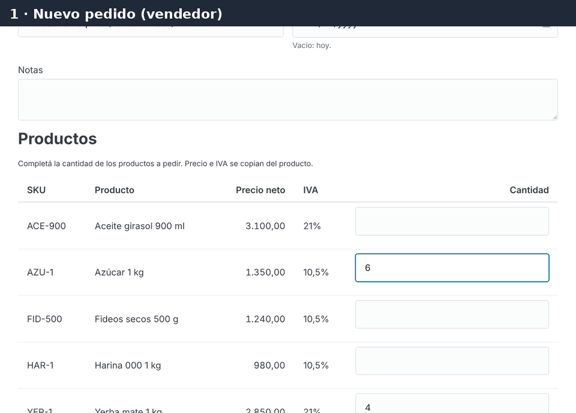
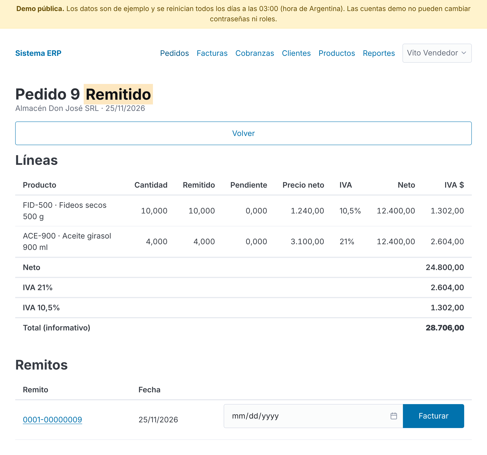
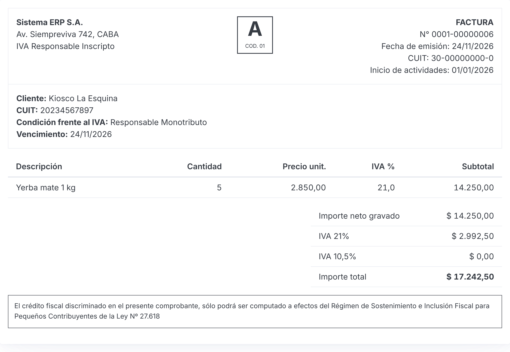
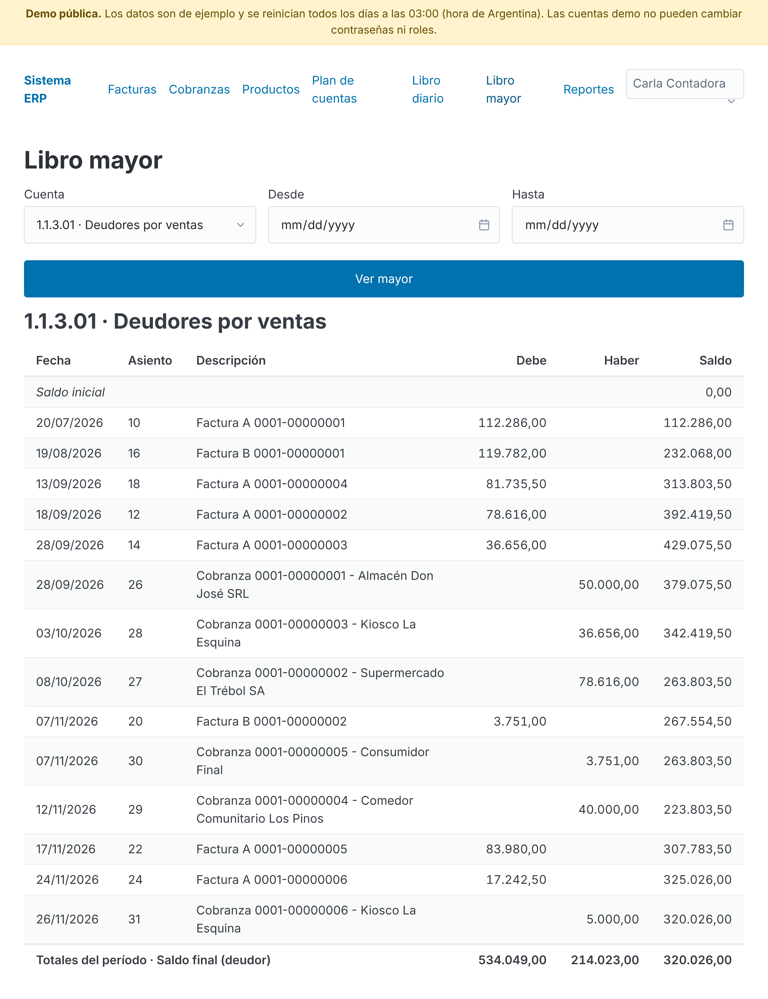
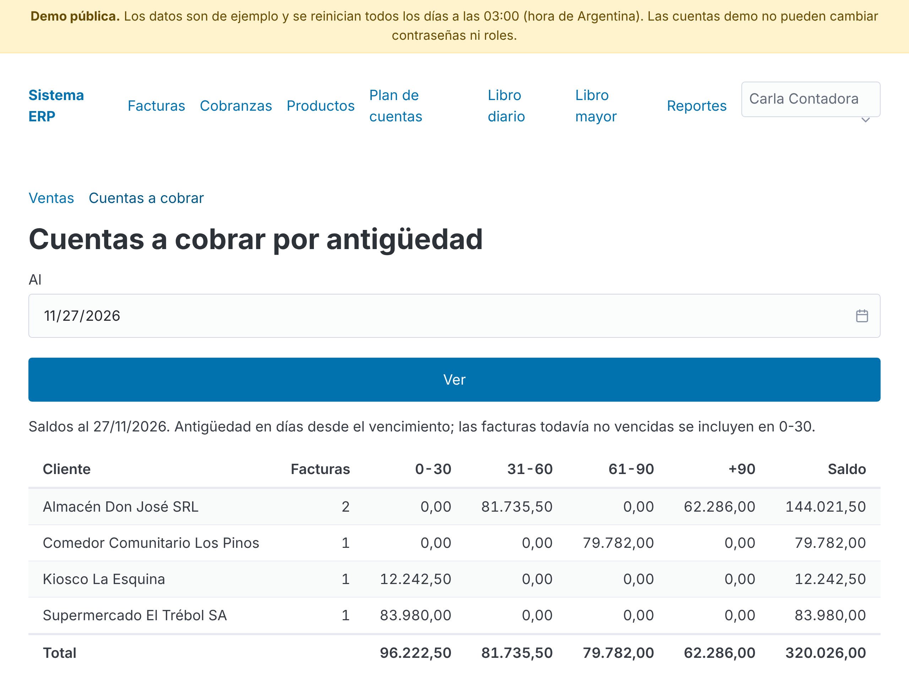

# Sistema ERP

[](https://github.com/mustang-the-first/sistema-erp/actions/workflows/ci.yml)

Mini-ERP con el flujo **order-to-cash** completo (pedido → remito → factura → cobranza) que genera
**asientos contables automáticos por partida doble**. Contexto argentino: IVA 21% y 10,5%,
facturas A y B simplificadas (incluida la leyenda de la Ley 27.618 para monotributistas), sin
integración con ARCA.

Proyecto de portfolio. El diseño completo, con el modelo de datos, los contratos de la API y las
decisiones tomadas, está en [`docs/plan.md`](docs/plan.md).

> **Demo online:** _(link pendiente: se agrega al publicar el deploy)_. Usuarios y contraseña
> están en la página de login de la demo. Los datos se reinician todos los días.



| | |
|---|---|
| **Pedido** con su remito pendiente de facturar  | **Factura A imprimible** a monotributista, con la leyenda de la Ley 27.618  |
| **Libro mayor** de Deudores por ventas, con saldo acumulado  | **Cuentas a cobrar** por antigüedad (el total coincide con el mayor)  |

## Qué hace

| Módulo | Funcionalidad |
|---|---|
| **Usuarios** | Login con sesiones en base de datos, roles admin / vendedor / contador, alta y baja de usuarios |
| **Catálogo y stock** | Productos, clientes y proveedores (CUIT con dígito verificador); stock como libro de movimientos; ajustes (carga inicial, diferencia de conteo, rotura) con su asiento |
| **Ventas** | Pedidos (borrador → confirmado → entregado), remitos parciales que descuentan stock, facturas A/B con numeración por letra y punto de venta |
| **Contabilidad** | Plan de cuentas jerárquico, asientos automáticos, libro diario y libro mayor con saldo inicial y acumulado |
| **Cobranzas** | Recibos en efectivo o transferencia aplicados a una o varias facturas, cuenta corriente por cliente |
| **Reportes** | Ventas por día / mes / cliente / producto, stock bajo, cuentas a cobrar con antigüedad de saldos |

Todo está disponible como **API JSON** (`/api/v1`, documentada en `/docs`) y como **interfaz web**
con Jinja2 + HTMX. Las dos usan los mismos services.

### Asientos que genera cada operación

| Operación | Debe | Haber |
|---|---|---|
| Factura A o B | Deudores por ventas (total) | Ventas (neto) · IVA DF 21% · IVA DF 10,5% |
| Remito | Costo de mercaderías vendidas | Mercaderías (al costo estándar) |
| Cobranza | Caja o Banco | Deudores por ventas |
| Ajuste de stock + | Mercaderías | Capital (carga inicial) o Sobrantes de inventario |
| Ajuste de stock − | Faltantes y roturas | Mercaderías |

Ejemplo: una factura con neto $1.000 al 21% y $500 al 10,5% da Deudores 1.762,50 al debe, y
Ventas 1.500,00, IVA 21% 210,00 e IVA 10,5% 52,50 al haber.

## Stack y arquitectura

Python 3.12 · FastAPI · SQLAlchemy 2 + Alembic · PostgreSQL 17 · Jinja2 + HTMX + Pico CSS ·
pytest · Docker Compose · GitHub Actions.

```
routers (api JSON / web HTMX)  →  services (lógica de negocio)  →  repositories  →  models
```

- **La lógica de negocio vive en los services.** Los routers solo validan, llaman a un service y
  serializan.
- **Una transacción por request.** El commit ocurre antes de enviar la respuesta: si falla, la API
  responde 500 y no queda nada a medias.
- **Invariantes protegidas también en la base de datos:**
  - un trigger diferido rechaza los asientos desbalanceados al COMMIT;
  - CHECK de una sola columna (debe o haber) por línea de asiento y `stock_qty >= 0`;
  - UNIQUE de un asiento por documento de origen y de numeración por tipo, letra y punto de venta.
- **Concurrencia:** stock y numeración con `SELECT … FOR UPDATE`; los productos se bloquean siempre
  ordenados por id, así dos remitos simultáneos no generan deadlock. La numeración no tiene huecos.
- **Dinero siempre en `Decimal`.** El IVA se calcula por línea, con redondeo half-up a 2 decimales.
- **Un único formato de error:** `{"detail", "code"}`. En la web, los errores se muestran en
  `#flash` y el request se revierte completo.

## Cómo correrlo

Requisitos: [uv](https://docs.astral.sh/uv/) y Docker.

```bash
cp .env.example .env
make install        # dependencias
make db             # PostgreSQL en Docker (bases erp y erp_test)
make migrate        # migraciones
uv run python -m scripts.seed_demo   # datos de demo (opcional)
make run            # http://localhost:8000   ·   API en /docs
```

O todo en contenedores: `make up`.

### Usuarios de demo

`seed_demo` crea un usuario por rol. La contraseña se toma de `ERP_DEMO_PASSWORD` (en desarrollo,
si no está definida, es `demo-erp-2026`; en producción es obligatoria).

| Usuario | Rol | Ve |
|---|---|---|
| `admin@demo.local` | Admin | Todo: usuarios, proveedores, stock y ajustes |
| `vendedor@demo.local` | Vendedor | Pedidos, remitos, facturas, cobranzas, clientes, reportes de ventas y stock bajo |
| `contador@demo.local` | Contador | Facturas, cobranzas, plan de cuentas, libro diario, libro mayor, ventas y cuentas a cobrar |

Los datos de demo cubren unos 4 meses: 8 facturas A y B, cobranzas parciales y totales, saldos en
los cuatro tramos de antigüedad, un pedido en borrador, uno confirmado sin entregar y un remito
pendiente de facturar (con el botón "Facturar" en la página del pedido).

Para un admin propio: `uv run python -m scripts.create_admin --email ... --name ...`.

## Producción y demo pública

- **Variables obligatorias en producción** (`ERP_ENV=production`): `ERP_DATABASE_URL` (o
  `DATABASE_URL`; se aceptan URLs `postgres://`) y `ERP_SECRET_KEY` (32+ caracteres). Con
  `ERP_DEMO_MODE=true` también `ERP_DEMO_PASSWORD`. Si falta alguna, **la app no arranca** y dice
  cuál falta. Ver [`.env.example`](.env.example).
- **Al arrancar** el contenedor corre `alembic upgrade head` y después uvicorn (con
  `--proxy-headers`, para URLs https detrás del proxy del proveedor). Healthcheck: `GET /health`.
- **Cookies de sesión** `HttpOnly`, `SameSite=Lax` y `Secure` en producción; la documentación
  `/docs` se desactiva.
- **Modo demo** (`ERP_DEMO_MODE=true`): banner en todas las páginas; las cuentas demo no pueden
  cambiar contraseñas ni roles, ni desactivar usuarios; la página de login muestra las cuentas.
- **Reset diario:** `make demo-reset` (o `python -m scripts.reset_demo`) vacía la base y vuelve a
  cargar la demo en una sola transacción; se niega a correr si `ERP_DEMO_MODE` no es `true`. Lo
  programa [`.github/workflows/demo-reset.yml`](.github/workflows/demo-reset.yml) todos los días a
  las 03:00 (Argentina), una vez definidos la variable `DEMO_RESET_ENABLED=true` y los secretos
  `DEMO_DATABASE_URL`, `DEMO_SECRET_KEY` y `DEMO_PASSWORD`.

## Tests y calidad

```bash
make lint    # ruff + mypy estricto (core y services)
make test    # pytest con cobertura
make check   # lo mismo que corre el CI
```

Son más de 1.200 tests contra PostgreSQL real, con 99% de cobertura:

- **Unitarios:** reglas puras (cálculo de IVA, letra de factura, armado de asientos, dígito
  verificador del CUIT).
- **Integración:** services, API y vistas web. Cada test corre dentro de un savepoint que se
  revierte al final.
- **Permisos:** una matriz que prueba cada ruta web con cada rol mediante requests reales, y falla
  si se agrega una ruta sin declarar sus roles.
- **Concurrencia:** threads con conexiones separadas.
  - Stock: nunca queda negativo y no hay deadlocks.
  - Numeración: sin huecos.
  - Cobranzas: dos recibos simultáneos no pueden sobrepagar una factura.
- **End-to-end** ([`tests/e2e/test_order_to_cash.py`](tests/e2e/test_order_to_cash.py)): recorre
  el flujo completo por HTTP y cruza los módulos entre sí:
  - el saldo de Deudores en el mayor coincide con la suma de las cuentas corrientes y con el
    reporte de cuentas a cobrar;
  - Mercaderías coincide con la suma de los movimientos de stock valuados;
  - Ventas e IVA coinciden con el reporte de ventas;
  - el diario está balanceado y el balance de sumas y saldos da cero.

Un cuelgue es un fallo, nunca una espera: los tests tienen timeout y las conexiones usan
`lock_timeout`, `statement_timeout` e `idle_in_transaction_session_timeout`.

## Estructura

```
app/
  core/          configuración, sesión de DB, seguridad, errores, dinero, dependencias de auth
  models/        SQLAlchemy 2 (19 tablas)
  services/      lógica de negocio; posting.py (asientos), stock_ledger.py, sequences.py,
                 invoice_balance.py son la base compartida
  repositories/  consultas
  routers/api/   API JSON          routers/web/   vistas HTMX
  templates/     Jinja2
migrations/      Alembic
scripts/         seed_chart_of_accounts, seed_demo, create_admin
tests/           unit/ · integration/ · e2e/ · factories/
docs/plan.md     diseño y decisiones
```

## Cómo se construyó

El proyecto se planificó y desarrolló por olas (detalle en [`docs/plan.md`](docs/plan.md)):

- [x] **Ola 0:** esqueleto (Docker, CI, `/health`).
- [x] **Ola 1:** fundación (modelos, migración, motor de asientos, ledger de stock, numeración).
- [x] **Ola 2:** siete módulos desarrollados en paralelo por agentes, cada uno con archivos propios y
  una base de test propia. Se mergearon de a uno, con `make check` después de cada merge.
- [x] **Ola 3:** integración. Correcciones transversales (roles, CSRF, errores web, formato único
  de 422), test end-to-end, datos de demo y este README.
- [ ] **Ola 4:** deploy y demo online. Ya están el modo demo, el reset diario, la configuración de
  producción, las capturas y el GIF; falta elegir proveedor y publicar.

## Licencia

[MIT](LICENSE).

## Fuera de alcance

Notas de crédito, anulaciones, compras, cierre de ejercicio e integración con ARCA. Los
proveedores existen solo como catálogo.
