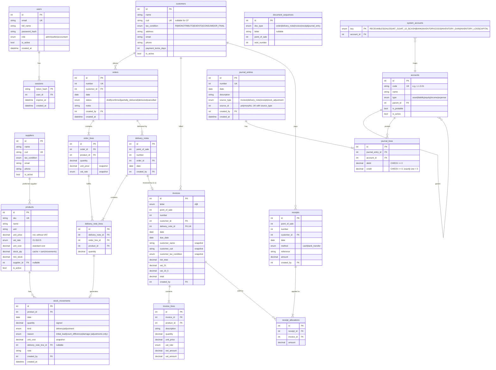

# Plan aprobado — Mini-ERP order-to-cash

Estado: **aprobado** (2026-11-27). Este documento es la fuente de verdad para todas las olas de
trabajo. Cambios al plan → se acuerdan primero y se actualizan acá.

## Índice

1. [Estructura de carpetas](#1-estructura-de-carpetas)
2. [Modelo de datos](#2-modelo-de-datos)
3. [Endpoints](#3-endpoints-json-apiv1)
4. [Asientos automáticos](#4-asientos-automáticos)
5. [Olas de trabajo y propiedad de archivos](#5-olas-de-trabajo-y-propiedad-de-archivos)
6. [Decisiones tomadas](#6-decisiones-tomadas)

---

## 1. Estructura de carpetas

Capas como carpetas; dentro de cada capa, un archivo por módulo (así cada agente es dueño de
archivos concretos).

```
app/
  main.py                 app factory, middlewares, registro de routers
  core/                   config, db (engine, get_db), security (hash, tokens de sesión),
                          deps (current_user, require_roles), errors (dominio → HTTP),
                          money (Decimal, redondeo, cálculo de línea)
  models/                 SQLAlchemy 2: base, users, catalog, stock, sales, accounting,
                          collections, sequences
  schemas/                Pydantic v2 por módulo
  repositories/           base.py genérico + uno por módulo
  services/               uno por módulo + piezas de la Fundación:
                          posting.py, stock_ledger.py, sequences.py, invoice_balance.py
  routers/api/            JSON /api/v1 (contrato, OpenAPI)
  routers/web/            HTML Jinja2 + HTMX (finos, llaman a los mismos services)
  templates/              base.html, partials/, una carpeta por módulo
  static/                 htmx.min.js, css
migrations/               Alembic
scripts/                  seed_chart_of_accounts.py, seed_demo.py, create_admin.py
tests/
  conftest.py             Postgres real, savepoint por test, client_as(role)
  factories/              builders por modelo
  unit/<module>/          lógica pura, sin DB
  integration/<module>/   services + repos + API contra Postgres
  e2e/                    flujo order-to-cash completo
docs/plan.md              este documento
```

### Convenciones técnicas

- SQLAlchemy **sync** + psycopg 3.
- **Transacción por request:** `get_db` es una dependency con `yield` declarada como
  `Depends(get_db, scope="function")`: el commit ocurre al salir de la dependency y **antes** de
  enviar la respuesta. Error en el commit → 500. Los services solo hacen `flush()`.
- Dinero `Numeric(14,2)`, cantidades `Numeric(12,3)`, siempre `Decimal`. IVA por línea con
  `ROUND_HALF_UP` a 2 decimales; totales = suma de líneas.
- Excepciones de dominio (`NotFound`, `BusinessRuleViolation`, `Forbidden`) → 404 / 422 / 403.
- Remitos, facturas, cobranzas y asientos son **inmutables**.
- **Locks:** `SELECT ... FOR UPDATE` sobre `products` (stock) y `document_sequences` (numeración).
  Con varios productos, siempre **ordenados por `product_id`** para evitar deadlocks.
- Auth con sesiones en DB (`sessions`, se guarda el hash del token), cookie `HttpOnly` +
  `SameSite=Lax`; CSRF con token de sesión enviado en un header por HTMX.

---

## 2. Modelo de datos



### Invariantes

- Asiento: Σdebe = Σhaber; solo cuentas `is_postable` y activas; un asiento por origen
  (`UNIQUE(source_type, source_id)`).
- `products.stock_qty` = Σ`stock_movements.quantity`; nunca negativo.
- Σ cantidades remitidas por línea de pedido ≤ cantidad pedida.
- Cobranza: Σ asignaciones = monto; cada asignación ≤ `invoice_balance` de esa factura.
- Numeración única por (tipo, letra, punto de venta), sin huecos, vía `document_sequences`.
- **Letra de factura** (emisor RI):

  | Condición del cliente | Letra | Notas |
  |---|---|---|
  | Responsable Inscripto | **A** | CUIT obligatorio |
  | Monotributo | **A** | CUIT obligatorio; la vista imprimible muestra la leyenda de la Ley 27.618 |
  | Exento | **B** | |
  | Consumidor Final | **B** | precios con IVA incluido en la vista |

  Leyenda Ley 27.618 (texto fijo en una constante):
  *"El crédito fiscal discriminado en el presente comprobante, sólo podrá ser computado a efectos
  del Régimen de Sostenimiento e Inclusión Fiscal para Pequeños Contribuyentes de la Ley Nº 27.618"*.
  Se decide por `invoices.customer_tax_condition` (snapshot), sin columna extra.

- **Saldo de factura:** `total − Σ receipt_allocations.amount`. Existe **una sola**
  implementación en `app/services/invoice_balance.py` (Fundación): `invoice_balance(session, id)`
  y un selectable reutilizable (`invoice_balances_subquery()`) para listados y agregaciones.
  Ventas (estado open/paid), Cobranzas y Reportes la usan; ninguno la reimplementa.

---

## 3. Endpoints (JSON `/api/v1`)

Roles: **A** admin · **V** vendedor (`seller`) · **C** contador (`accountant`). El admin puede
todo.

### Auth y usuarios
| Método | Ruta | Body / query | Roles |
|---|---|---|---|
| POST | `/auth/login` | `{email, password}` → cookie de sesión + usuario | público |
| POST | `/auth/logout` | → 204 | todos |
| GET | `/auth/me` | | todos |
| GET / POST | `/users` | `{email, full_name, role, password}` | A |
| GET / PATCH | `/users/{id}` | `{full_name?, role?, is_active?, password?}` | A |

### Catálogo y stock
| Método | Ruta | Body / query | Roles |
|---|---|---|---|
| GET / POST | `/products` | `?q&active`; `{sku, name, unit, unit_price, vat_rate, unit_cost, min_stock, supplier_id?}` | lee todos; escribe A |
| GET / PATCH | `/products/{id}` | baja lógica vía `is_active` (sin DELETE) | ídem |
| GET / POST | `/customers` | `{name, cuit?, tax_condition, address, email, phone, payment_terms_days}` | V, A |
| GET / PATCH | `/customers/{id}` | | V, A |
| GET / POST | `/suppliers` | | A |
| GET / PATCH | `/suppliers/{id}` | | A |
| GET | `/stock/movements` | `?product_id&from&to&kind` | A |
| POST | `/stock/adjustments` | `{product_id, quantity (±), reason, note, date}` → movimiento + asiento | A |
| GET | `/stock/adjustments` | `?product_id&from&to&reason` → `{items, total}` de `{movement, journal_entry_number}` | A |

### Ventas
| Método | Ruta | Body / query | Roles |
|---|---|---|---|
| GET / POST | `/orders` | `?status&customer_id&from&to`; `{customer_id, date, notes, lines:[{product_id, quantity}]}` — precio e IVA se copian del producto | V |
| GET / PATCH | `/orders/{id}` | PATCH solo en `draft` (reemplaza líneas) | V |
| POST | `/orders/{id}/confirm` | draft → confirmed | V |
| POST | `/orders/{id}/cancel` | solo sin remitos | V |
| POST | `/orders/{id}/delivery-notes` | `{date, lines:[{order_line_id, quantity}]}` — valida pendiente y stock, descuenta stock, asiento CMV | V |
| GET | `/delivery-notes`, `/delivery-notes/{id}` | `?order_id&invoiced` | V, C |
| POST | `/delivery-notes/{id}/invoice` | `{date}` — letra automática, numeración, asiento | V |
| GET | `/invoices`, `/invoices/{id}` | `?customer_id&letter&from&to&status=open\|paid` | V, C |

### Contabilidad
| Método | Ruta | Body / query | Roles |
|---|---|---|---|
| GET / POST | `/accounts` | árbol; `{code, name, type, parent_id, is_postable}` | C |
| PATCH | `/accounts/{id}` | `{name?, is_active?}` — no se cambia `type` ni se desactiva con saldo | C |
| GET | `/journal-entries` | libro diario: `?from&to&source_type`, paginado | C |
| GET | `/journal-entries/{id}` | | C |
| GET | `/ledger/{account_id}` | libro mayor: `?from&to` → saldo inicial, movimientos con saldo acumulado, saldo final | C |

### Cobranzas y cuenta corriente
| Método | Ruta | Body / query | Roles |
|---|---|---|---|
| GET / POST | `/receipts` | `{customer_id, date, method, reference, allocations:[{invoice_id, amount}]}` → asiento | V, C |
| GET | `/receipts/{id}` | | V, C |
| GET | `/customers/{id}/open-invoices` | facturas con saldo > 0 | V, C |
| GET | `/customers/{id}/statement` | `?from&to` → saldo inicial; facturas al debe, cobranzas al haber, saldo acumulado | V, C |

### Reportes
| Método | Ruta | Query | Roles |
|---|---|---|---|
| GET | `/reports/sales` | `?from&to&group_by=day\|month\|customer\|product` → neto, IVA 21, IVA 10,5, total | V, C |
| GET | `/reports/low-stock` | `stock_qty ≤ min_stock` | A, V |
| GET | `/reports/receivables` | `?as_of` → saldo por cliente con antigüedad 0-30 / 31-60 / 61-90 / +90 días desde el vencimiento | C |

### Vistas web (HTMX)

Los permisos de cada vista web se definen acá, no en la navegación (que solo muestra enlaces).
`tests/integration/foundation/test_web_roles.py` verifica esta tabla ruta por ruta, para cada
rol, con requests reales. Sin sesión, toda vista (salvo `/login`) redirige a `/login`.

| Vista | Métodos | Roles (+A) |
|---|---|---|
| `/login`, `/logout` | GET, POST / POST | público |
| `/users`, `/users/{id}` | GET, POST, PATCH | A |
| `/products` (listado) | GET | V, C |
| `/products/{id}` (formulario de edición), alta y edición | GET, POST, PATCH | A |
| `/customers`, `/customers/{id}` | GET, POST, PATCH | V |
| `/suppliers`, `/suppliers/{id}` | GET, POST, PATCH | A |
| `/stock`, `/stock/adjustments` | GET, POST | A |
| `/orders`, `/orders/new`, `/orders/{id}` y acciones (confirmar, anular, remitir) | GET, POST, PATCH | V |
| `/delivery-notes`, `/delivery-notes/{id}` | GET | V, C |
| `/invoices`, `/invoices/{id}` (imprimible) | GET | V, C |
| `/delivery-notes/{id}/invoice` (facturar) | POST | V |
| `/receipts/new`, `/receipts/new/open-invoices`, `/receipts/{id}`, `/receipts` | GET, POST | V, C |
| `/customers/{id}/statement` | GET | V, C |
| `/accounting/accounts`, `/accounting/journal`, `/accounting/ledger` | GET, POST, PATCH | C |
| `/reports/sales` | GET | V, C |
| `/reports/low-stock` | GET | V |
| `/reports/receivables` | GET | C |

### Infra
`GET /health` → `{"status": "ok"}` (público).

---

## 4. Asientos automáticos

### Plan de cuentas inicial (seed)

| Código | Cuenta | Tipo | `system_accounts` |
|---|---|---|---|
| 1.1.1.01 | Caja | asset | CASH |
| 1.1.1.02 | Banco c/c | asset | BANK |
| 1.1.3.01 | Deudores por ventas | asset | RECEIVABLES |
| 1.1.4.01 | Mercaderías | asset | INVENTORY |
| 2.1.3.01 | IVA Débito Fiscal 21% | liability | VAT_21 |
| 2.1.3.02 | IVA Débito Fiscal 10,5% | liability | VAT_10_5 |
| 3.1.01 | Capital | equity | CAPITAL |
| 4.1.01 | Ventas | income | SALES |
| 4.2.01 | Sobrantes de inventario | income | INVENTORY_GAIN |
| 5.1.01 | Costo de mercaderías vendidas | expense | COGS |
| 5.2.01 | Faltantes y roturas de inventario | expense | INVENTORY_LOSS |

Rubros padre (1, 1.1, 1.1.1, …) con `is_postable = false`.

### Asientos por operación

| Operación | Debe | Haber |
|---|---|---|
| **Factura A o B** | Deudores por ventas = total | Ventas = neto · IVA DF 21% = iva21 · IVA DF 10,5% = iva10,5 (solo líneas > 0) |
| **Remito** (inventario permanente, costo estándar) | CMV = Σ cant × `unit_cost` | Mercaderías |
| **Cobranza efectivo** | Caja | Deudores por ventas |
| **Cobranza transferencia** | Banco c/c | Deudores por ventas |
| **Ajuste + (diferencia de conteo)** | Mercaderías = cant × `unit_cost` | Sobrantes de inventario |
| **Ajuste − (diferencia de conteo / rotura)** | Faltantes y roturas | Mercaderías |
| **Ajuste + (carga inicial)** | Mercaderías | Capital |

Ejemplo: factura con neto $1.000 al 21% y $500 al 10,5% →
Debe Deudores 1.762,50 / Haber Ventas 1.500,00, IVA 21% 210,00, IVA 10,5% 52,50.

`unit_cost` se copia (snapshot) a cada `stock_movement`; cambiar el costo del producto no
revaloriza el stock existente.

Motor: `posting.post_entry(session, EntryDraft)` valida balance, cuentas imputables y origen único,
y numera. Los builders (`build_invoice_entry`, `build_delivery_entry`, `build_receipt_entry`,
`build_adjustment_entry`) son funciones puras con tests unitarios.

---

## 5. Olas de trabajo y propiedad de archivos

### Reglas para todos los agentes

- Cada agente toca **solo** sus archivos e importa **solo** de archivos de la Fundación.
- Después de la Ola 1 **no se toca el esquema** (`app/models/`, `migrations/`). Si un agente lo
  necesita, lo reporta y no lo hace.
- Cada agente trabaja en su propio worktree y entrega cumpliendo la definición de "terminado" de
  `CLAUDE.md`.

### Ola 0 — Esqueleto (hecha)
CLAUDE.md, pyproject, Dockerfile, docker-compose (con `erp` y `erp_test`), Alembic vacío,
`/health`, un test y CI.

### Ola 1 — Fundación (1 agente, secuencial)
Dueño de:
- `app/core/*`: `db.py` (engine, `get_db` usado con `Depends(get_db, scope="function")`),
  `security.py`, `deps.py` (`get_current_user`, `require_roles`), `errors.py`, `money.py`
  (redondeo y `compute_line_amounts`).
- `app/models/*` completos + **migración inicial** + `migrations/env.py` con `Base.metadata`.
- `app/repositories/base.py`.
- `app/services/posting.py`, `stock_ledger.py` (movimientos con lock **ordenado por
  `product_id`**, validación de no-negativo), `sequences.py`, `invoice_balance.py`.
- `app/main.py` con **todos** los routers registrados como stubs vacíos y los handlers de errores.
- `templates/base.html` (layout, nav por rol, htmx), `static/`.
- `tests/conftest.py`: engine de test, sesión por test con
  `join_transaction_mode="create_savepoint"` y rollback, `client_as(role)`.
- `tests/factories/*`, `scripts/seed_chart_of_accounts.py`.

Tests obligatorios:
- Unit de `money` y de validación de `posting`.
- Integración de `posting`, `stock_ledger`, `sequences` e `invoice_balance`.
- **Commit fallido → 500:** un endpoint de prueba cuyo commit falla (p. ej. viola una constraint
  diferida o se fuerza el error en el commit) responde 500 y no persiste nada.
- **Concurrencia (2 tests, conexiones separadas, limpieza por `TRUNCATE`):**
  1. Stock: N hilos descuentan del mismo stock a la vez → nunca queda negativo y
     `stock_qty` = Σ movimientos; dos remitos con los mismos productos en orden inverso no
     generan deadlock.
  2. Numeración: N hilos piden número del mismo `document_sequences` → números únicos y
     correlativos, sin huecos.
- `alembic upgrade head` sobre DB vacía + `alembic check` sin diferencias.

**Gate:** al terminar la Ola 1 se frena y se muestran modelos y migración para aprobación antes
de lanzar la Ola 2.

### Ola 2 — 7 agentes en paralelo (dependen solo de la Fundación)

Reglas adicionales (aprobadas en el gate de la Ola 1):

1. Cada agente usa su propia base de test: `ERP_TEST_AGENT=<a|b|c|d1|d2|e|f>`.
2. **Nadie modifica** `app/models/`, `migrations/`, `app/core/`, `app/main.py`,
   `app/repositories/base.py`, `app/services/{posting,stock_ledger,sequences,invoice_balance,chart_seed}.py`,
   `tests/conftest.py`, `tests/factories/`, `templates/base.html`, `pyproject.toml`/`uv.lock`,
   `Makefile` ni el CI. Si necesita un cambio, lo reporta y sigue con un stub.
3. Cada agente termina con `make check` verde en su worktree y entrega un resumen: endpoints
   implementados, tests y desvíos del contrato.
4. Merge de a uno, con `make check` después de cada merge, en orden: A, B, C, D1, D2, E, F.

Convenciones compartidas de la API (para que los 7 módulos sean consistentes):

- Montos y cantidades se serializan como **string decimal** (`"1762.50"`, Pydantic v2 con
  `Decimal`); fechas ISO `YYYY-MM-DD`.
- Listados: `?limit=50&offset=0` (máx. 200) y respuesta `{"items": [...], "total": n}`.
- Errores: **un solo formato** `{"detail", "code"}` para todo (401/403/404/422). Las reglas de
  negocio usan su propio `code`; la validación de schemas usa `code: "validation_error"` con
  `detail` = `campo: mensaje; ...`. En vistas web, los 404/422 de HTMX y de escrituras se
  muestran en `#flash` (status 200, `HX-Retarget`) vía el handler compartido; el 403 conserva
  su status. Ningún router web arma su propia respuesta de error.
- Roles con `require_roles(...)` en el router o el endpoint; el admin siempre pasa.
- `created_by` = usuario actual; fecha por defecto `app.core.clock.today()`; punto de venta
  `get_settings().point_of_sale`.
- **D2:** la factura A a un cliente Monotributo expone `legend` (texto de la Ley 27.618) en la
  respuesta de la API y lo muestra en la vista imprimible; `null`/ausente en los demás casos.
  Tiene su propio test en ambos lugares.

Patrón de archivos por módulo `<m>`: `routers/api/<m>.py`, `routers/web/<m>.py`,
`services/<m>.py`, `repositories/<m>.py`, `schemas/<m>.py`, `templates/<m>/`,
`tests/unit/<m>/`, `tests/integration/<m>/`.

| Agente | Módulos `<m>` | Alcance | Usa de la Fundación |
|---|---|---|---|
| **A · Auth** | `auth`, `users` | login/logout, sesiones, CRUD usuarios, `scripts/create_admin.py` | security, deps |
| **B · Catálogo y stock** | `catalog`, `stock` | productos, clientes, proveedores, movimientos, ajustes + asiento | stock_ledger, posting |
| **C · Contabilidad** | `accounting` | plan de cuentas, libro diario, libro mayor (no toca `posting.py`) | modelos |
| **D1 · Pedidos y remitos** | `orders`, `delivery_notes` | ciclo del pedido, remitos parciales, descuento de stock, asiento CMV | stock_ledger, posting, sequences |
| **D2 · Facturas** | `invoices` | factura desde remito, letra A/B (+ leyenda Ley 27.618), cálculo IVA, numeración, asiento, vista imprimible, listado open/paid | posting, sequences, money, invoice_balance |
| **E · Cobranzas** | `collections` | cobranzas, asignaciones, facturas abiertas, cuenta corriente, asiento | posting, sequences, invoice_balance |
| **F · Reportes** | `reports` | ventas por período, stock bajo, cuentas a cobrar con antigüedad | invoice_balance, modelos |

D1, D2, E y F leen productos, clientes, remitos y facturas con `repositories/base.py` o queries
propias, y arman sus datos de prueba con `tests/factories/`. No dependen de código de otro agente
de la Ola 2.

### Ola 3 — Integración
Dueño de: `tests/e2e/test_order_to_cash.py`, `scripts/seed_demo.py`, `README.md`.
- Flujo: pedido → remitos parciales → factura A (RI), factura A (Monotributo, con leyenda),
  factura B (CF) → cobranzas parcial y total.
- Chequeos cruzados:
  - Saldo de Deudores por ventas en el mayor = Σ cuentas corrientes = total del reporte de
    cuentas a cobrar.
  - **Mercaderías en el mayor = Σ(`quantity` × `unit_cost`) de cada `stock_movement`** (no
    `stock_qty` × costo actual).
  - IVA DF 21% y 10,5% en el mayor = totales del reporte de ventas.
  - Σdebe = Σhaber de todo el diario.
- Corregir inconsistencias entre módulos.
- Después de la Ola 3 se evalúan **notas de crédito** como extra (requiere aprobación).

### Ola 4 — Deploy y demo
- Deploy en Render o Fly.io (Postgres gestionado, migraciones al arrancar, secretos por env).
- `seed_demo.py` con un usuario por rol (admin, vendedor, contador) y datos de ejemplo.
- Capturas de las pantallas principales y link a la demo en el README.

Orden: **Ola 0 → Ola 1 → gate → Ola 2 (7 en paralelo) → merge → Ola 3 → Ola 4.**

---

## 6. Decisiones tomadas

1. Hay dos interfaces, la API JSON y las vistas HTMX, y comparten los mismos services.
2. El CMV se registra en el remito, al costo estándar del producto.
3. La carga inicial de stock es un ajuste con motivo `initial_load` contra Capital.
4. Un remito genera una factura. Un pedido puede tener varios remitos parciales.
5. Quedan fuera de alcance las notas de crédito, las anulaciones, el cierre de ejercicio, el balance de sumas y saldos como endpoint y el módulo de compras. Los proveedores quedan solo como catálogo y como proveedor preferido.
6. Calidad: ruff, mypy estricto sobre `app/core` y `app/services`, y cobertura de services ≥ 90%.
7. Factura A para clientes RI y Monotributo (con leyenda de la Ley 27.618 para Monotributo); factura B para Exento y CF.
8. La sesión de DB se inyecta con `Depends(get_db, scope="function")`, así el commit ocurre antes de enviar la respuesta.
9. Los tests usan savepoints, y los de concurrencia usan conexiones separadas con `TRUNCATE`.
10. Los locks se toman ordenados por `product_id`.
11. `invoice_balance` tiene una única implementación, en la Fundación.
12. En el e2e, Mercaderías se valida contra la suma de los movimientos valuados.

### Desvíos aceptados (revisión de la Ola 2)

Cambios respecto del contrato original, revisados y aceptados:

| Módulo | Desvío | Motivo |
|---|---|---|
| B · Stock | `GET /stock/adjustments` (listado de ajustes con el número de asiento), no estaba en el contrato | Permite ver cada ajuste junto a su asiento sin cruzar a mano movimientos y diario |
| B · Catálogo | El SKU es único **sin distinguir mayúsculas** (`abc-1` = `ABC-1`) | Evita productos duplicados que solo difieren en mayúsculas |
| B · Catálogo | `payment_terms_days` (plazo de pago) va de **0 a 365** días; fuera de rango → 422 `invalid_payment_terms` | Un plazo negativo o mayor a un año es un error de carga |
| Stock | Todo `/stock` (API y web) es **solo admin**, incluidas las lecturas | Decisión posterior a la Ola 2 (antes `GET /stock/movements` era para todos) |
| B · Catálogo | La vista web `/products/{id}` es el formulario de edición: **solo admin**. V y C ven los productos en el listado | No se agrega una vista de solo lectura que no estaba en el alcance |

